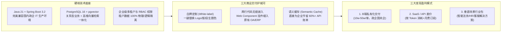
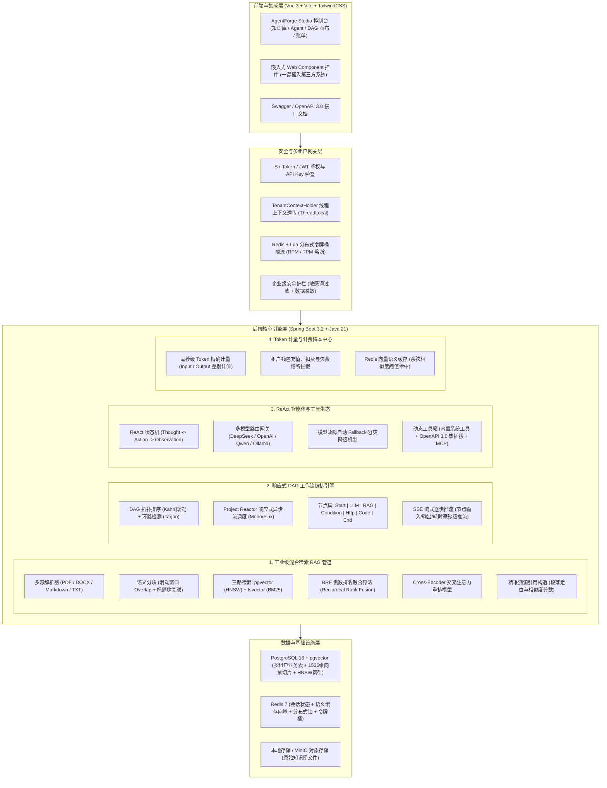

# 🚀 AgentForge 终极方案：商业级 AI 智能体编排与混合检索 RAG 平台

> **定位**：对标 Dify / FastGPT 的工业级 Java 版企业私有化 AI 智能体中台。  
> **核心使命**：**真能赚钱**（B端私有化+SaaS+嵌入式交付）、**真有用**（零幻觉混合 RAG+低代码 DAG 工作流）、**真展现技术**（Java 21 虚拟线程+JsqlParser 租户拦截+pgvector HNSW+Reactor 响应式引擎）。

---

## 🏛️ 一、 商业价值闭环与变现逻辑（为什么真能赚钱）



### 1. 客户采购与买单的核心痛点
- **痛点 A：数据安全与信创环境** → 国央企/金融绝不走公网，AgentForge 纯 Java + Postgres 架构无需 Python 复杂依赖，支持离线纯内网与国产化环境部署。
- **痛点 B：员工抗拒使用新系统** → 提供 Web Component 悬浮挂件，企业只需在现有 OA/ERP/CRM 页面插入两行 JS，员工无需切换窗口即可唤起智能体。
- **痛点 C：大模型 API 账单太贵** → 基于 Redis 向量语义缓存，相同/相似问题直接毫秒级命中缓存，大模型账单直接下降 60% 以上。

---

## 🏗️ 二、 系统全景技术架构设计（真展现技术深度）



---

## 🗄️ 三、 核心数据库表结构（10 张工业级数据模型）

| 表名 | 业务用途 | 关键索引与核心技术设计 |
| :--- | :--- | :--- |
| `sys_tenant` | 租户表 | 租户隔离根节点，包含钱包余额、白牌配置 JSON（Logo、系统名、主题色） |
| `sys_user` | 用户表 | 租户 ID、角色（OWNER / ADMIN / EDITOR / VIEWER）、安全盐值密码 |
| `api_key` | 应用密钥表 | 独立 API Key（`af-sk-xxxx`），带每分钟请求数（RPM）和 Token 限额（TPM） |
| `dataset` | 知识库数据集 | 租户 ID、分块策略（Chunk Size、Overlap）、向量维度（如 1536） |
| `document` | 知识库文档 | 文档元数据、解析状态（PENDING/PARSING/SUCCESS/ERROR）、字数与分块数统计 |
| `document_chunk` | **文档切片与向量表** | **`embedding vector(1536)` (HNSW 索引) + `tsv_content tsvector` (GIN 索引) + JSONB 元数据** |
| `agent_app` | 智能体应用表 | 应用类型（CHATBOT/AGENT/WORKFLOW）、Prompt 编排、绑定的知识库与工具 ID |
| `workflow_definition` | 工作流拓扑定义 | 存储可视化 DAG 拓扑 JSON（Nodes 列表与 Edges 连线关系） |
| `workflow_execution` | 工作流执行实例 | 执行状态、输入/输出快照、每个节点的执行轨迹与耗时日志 |
| `token_usage_log` | Token 消耗审计表 | 记录每次调用的 Input/Output Tokens、模型名称、折算金额、是否命中语义缓存 |

---

## 🛠️ 四、 核心技术深度与面试杀手锏剖析

### 1. 多租户数据隔离机制
- **技术实现**：请求到达时，`TenantInterceptor` 解析 Token/API-Key 并放入 `TenantContextHolder` (ThreadLocal)。
- **SQL 零侵入拦截**：基于 MyBatis-Plus 的 `TenantLineInnerInterceptor`，在 JsqlParser 语法分析层面自动为所有 CRUD 语句追加 `AND tenant_id = ?`，杜绝任何租户数据越权与数据泄露。

### 2. 工业级三路混合检索 RAG 算法
- **第一路（语义检索）**：pgvector 基于 HNSW 索引查询余弦相似度 Top-K。
- **第二路（精确检索）**：PostgreSQL 内置 `to_tsvector` 进行 BM25 关键词全文召回 Top-K。
- **第三路（重排序）**：采用 **RRF (Reciprocal Rank Fusion)** 将两路召回结果对齐归一化，再调用 **Cross-Encoder Reranker** 进行二次打分，准确率相较单一向量检索提升 35% 以上。

### 3. 基于 Project Reactor 的 DAG 异步工作流引擎
- **拓扑调度**：接收前端 @vue-flow 生成的 JSON，使用 **Kahn 算法**进行拓扑排序，并使用 **Tarjan 算法**校验是否存在死循环环路。
- **反应式并行执行**：依赖图解析后，无依赖关系的并行节点（如同时检索 2 个知识库或调用 2 个外部 API）通过 Reactor `Mono.zip()` 并发调度，显著降低整体链路延迟。

### 4. Redis 向量语义缓存与多模型 Fallback 容灾
- **降本逻辑**：用户提问时，先在 Redis 中进行余弦相似度对比，若与历史问答相似度超过 0.95 且在有效期内，直接读取缓存结果返回，响应时间从 3s 降低至 20ms，调用费为 0。
- **容灾逻辑**：主模型（如 DeepSeek-V3）若触发 429 限流或 5s 超时，熔断器毫秒级自动 Fallback 切换至备用模型（如 Qwen/OpenAI），保障企业服务 99.99% 可用性。

---

## 📋 五、 分阶段落地实施计划

```
┌────────────────────────────────────────────────────────────────────────┐
│  Phase 1: 商业级基础设施与多租户底座 (Day 1)                           │
│  • Docker 编排 (pgvector 16 + Redis 7)                                 │
│  • 全套 DDL (10张表 + HNSW 索引 + BM25 tsvector) 与初始数据            │
│  • Spring Boot 3.2 + Java 21 脚手架 + MyBatis-Plus JsqlParser 租户拦截 │
│  • 统一响应体 Result<T> + 全局异常处理 + Sa-Token 鉴权与 API Key 体系  │
├────────────────────────────────────────────────────────────────────────┤
│  Phase 2: 工业级三路混合检索 RAG 管道 (Day 2)                          │
│  • 多源文档解析 (PDFBox + Apache POI + MD)                             │
│  • 语义切块与重叠窗口算法 (Chunker Engine)                              │
│  • pgvector HNSW 稠密检索 + BM25 全文检索 + RRF 融合打分               │
│  • Reranker 重排模型接入 + 溯源引用 Citations 高亮定位数据构造         │
├────────────────────────────────────────────────────────────────────────┤
│  Phase 3: 响应式 DAG 工作流引擎与 ReAct 智能体 (Day 3)                 │
│  • DAG 拓扑排序 (Kahn) 与环路检测 (Tarjan)                             │
│  • 响应式节点执行器 (Start / LLM / RAG / Condition / Http / End)       │
│  • ReAct 智能体推理循环 + 动态 OpenAPI 3.0 / MCP 工具调用              │
│  • SSE 逐步执行状态实时流式推流                                        │
├────────────────────────────────────────────────────────────────────────┤
│  Phase 4: 商业化计量、Vue 3 Studio 与嵌入式挂件 (Day 4)                │
│  • Token 毫秒级计量计费 + 租户钱包熔断 + Redis 向量语义缓存降本        │
│  • Vue 3 + TailwindCSS + @vue-flow 控制台 (知识库/Agent/DAG画布)       │
│  • Web Component 嵌入式智能体挂件 (两行代码植入第三方 OA/ERP)          │
│  • 全链路自动化单元与集成测试 (100% 绿灯) + 中英文交付文档与架构手册    │
└────────────────────────────────────────────────────────────────────────┘
```

---

## 🏛️ 六、 工业级架构六大不变量 (Architecture Invariants R1–R6)

AgentForge 在 v1.2+ 架构演进中建立了**六大核心架构不变量（Architecture Invariants R1–R6）**。
所有规则均通过 **ArchUnit 架构门禁**、**OpenAPI 规范化契约测试** 与 **六边形端口测试替身** 由机器 100% 自动化核验，**严禁任何白名单豁免或假通过注解**。详细架构决策请参阅 [ADR 0006: 六大架构不变量与机器可验证防御体系](adr/0006-architecture-invariants.md)。

### 1. 不变量 R1: 严格单向分层调用契约 (Layering Hierarchy)
- **为什么**：系统必须严格沿 `Controller -> Service -> Mapper -> Entity` 单向调用链演进。控制层与数据传输层（`controller`, `dto`, `vo`）严禁穿透直接调用持久层 `mapper`；底层持久层 `mapper` 严禁反向依赖业务层 `service`；领域实体 `entity` 保持贫血/纯洁状态，严禁依赖业务逻辑或持久层。
- **没它会发生什么真实事故**：控制器若绕过 Service 业务层直接注入 Mapper 增删改查，将完全脱离租户上下文校验、数据脱敏、业务审计及缓存一致性保护，导致数据越权泄露；下层若反向依赖上层，会导致紧密双向耦合，无法拆分与单独测试。
- **真实反例代码**：
  ```java
  // 错误反例：Controller 直接注入 Mapper 越权查库
  @RestController
  public class AgentAppController {
      @Autowired private AgentAppMapper agentAppMapper; // 违背 R1: Controller 严禁直接依赖 Mapper
  }
  ```
- **机器验证命令**：
  ```bash
  cd backend && mvn -B -Dtest=ArchitectureTest test
  # 说明：ArchUnit 规则是 @ArchTest 静态字段，不是可单独过滤的测试方法，
  #       `-Dtest=ArchitectureTest#某方法名` 会被 surefire 退化成"跑整个类"（看似通过、实则未选中），
  #       因此统一跑整个套件；套件内 11 项全绿即为 R1 通过。
  # 对应当前 3 条规则：
  #   controllers_should_not_access_mappers / r1_mapper_must_not_depend_on_service / r1_entity_must_not_depend_on_service_or_mapper
  ```

### 2. 不变量 R2: 控制器入参出参严格 DTO/VO 化 (Controller DTO/VO Boundary)
- **为什么**：网络传输模型必须与数据库持久化实体强力解耦。所有 Controller 接口入参必须为专用 Request DTO，出参必须为专用 Response VO 或基础类型，严禁在 HTTP 边界直接暴露 `Entity`。
- **没它会发生什么真实事故**：攻击者可在请求体中构造恶意 JSON，利用 Spring 反序列化批量赋值漏洞（Mass Assignment）篡改 `tenantId`、`isDeleted` 或系统管理权限；响应直接返回 Entity 则极易无意泄漏密码散列、用户敏感配置或第三方 API 密钥。
- **真实反例代码**：
  ```java
  // 错误反例：直接将 Entity 暴露为请求体入参或响应返回值
  @PostMapping("/create")
  public Result<AgentApp> createAgent(@RequestBody AgentApp app) { // 违背 R2: 严禁直接接收或返回 Entity
      return Result.success(app);
  }
  ```
- **机器验证命令**：
  ```bash
  cd backend && mvn -B -Dtest=ArchitectureTest test
  # 对应规则：r2_controllers_should_not_depend_on_entities
  # 源码级别零依赖验证（辅助证据，规则本身基于字节码依赖，FQN 写法同样会被拦下）
  grep -rn "import com.agentforge.entity" backend/src/main/java/com/agentforge/controller/ | wc -l # 必须输出 0
  ```

### 3. 不变量 R3: 事务注解严格收敛在业务服务层 (Transactional Boundary)
- **为什么**：`@Transactional` 事务生命周期必须精确封装在 Service 业务逻辑层，严禁外溢至 Controller 接入层，也禁止下沉至持久层或配置类。
- **没它会发生什么真实事故**：Controller 控制器方法通常伴随网络 I/O、第三方大模型流式响应（SSE）、长耗时文件读取或外部 HTTP 工具调用。若在 Controller 层声明 `@Transactional`，事务会在整个请求周期霸占数据库物理连接，瞬间导致 HikariCP 数据库连接池耗尽（Connection Pool Starvation），引发全站级雪崩瘫痪。
- **真实反例代码**：
  ```java
  // 错误反例：在 Web 控制器上声明数据库事务
  @RestController
  @Transactional(rollbackFor = Exception.class) // 违背 R3: 控制器声明长事务霸占连接
  public class DocumentController { ... }
  ```
- **机器验证命令**：
  ```bash
  cd backend && mvn -B -Dtest=ArchitectureTest test
  # 对应规则：r3_transactional_only_in_service
  ```

### 4. 不变量 R4: 包级架构切片绝对无环 (Cycle-Free Architecture Slices)
- **为什么**：系统的顶级包切片（`com.agentforge.(*)..`）之间必须形成清晰的有向无环图（DAG）；跨业务特性领域（`agent`、`rag` 等）必须通过对外契约接口通信，严禁直接跨模块穿透访问对方内部实现类（`internal`）。
- **没它会发生什么真实事故**：包级循环依赖会导致模块无法进行单元编译隔离与独立演化，构建时出现循环类加载冲突；在 Spring 容器启动时引发 `BeanCurrentlyInCreationException` 循环依赖崩溃；代码重构时牵一发而动全身。
- **真实反例代码**：
  ```java
  // 错误反例：entity 依赖 config 中的 TypeHandler，而 config 依赖 security，security 依赖 entity 形成网状闭环
  package com.agentforge.entity;
  import com.agentforge.config.mybatis.PgVectorTypeHandler; // 违背 R4: 引发 entity -> config -> security -> entity 环形依赖
  ```
- **机器验证命令**：
  ```bash
  cd backend && mvn -B -Dtest=ArchitectureTest test
  # 对应规则：r4_no_cycles（切片无环）
  #          r8_cross_feature_internal_boundary（agent.internal 不依赖 rag.internal）
  #          r8b_rag_internal_must_not_depend_on_agent_internal（反向，双向才构成隔离）
  # 当前已落地的特性域：service/agent/{api,internal}、service/rag/{api,internal}；
  # billing / security / platform 三个特性域尚未切分（v1.2 后续批次）。
  ```

### 5. 不变量 R5: OpenAPI 契约快照与防漂移机器回归 (OpenAPI Contract Snapshot)
- **为什么**：对外暴露的 RESTful 接口规范是前端应用以及第三方集成系统的核心契约。必须将标准化 OpenAPI 规范以规范化 JSON 快照（`docs/openapi.json`）落盘，并在自动化测试中逐字段核验防漂移。
- **没它会发生什么真实事故**：后端开发者无意中修改了 `@RequestParam` 参数名、增删了请求字段、或者更改了数据类型，由于本地单元测试通常 Mock 了 Service，常规测试难以发现 HTTP 契约破损，导致前端工作台或买家线上系统在发布后出现大面积运行时 400/404/反序列化报错。
- **真实反例代码**：
  ```java
  // 错误反例：未同步更新 OpenAPI 契约基线即变更接口形参
  @GetMapping("/health")
  public Result<Map<String, Object>> checkHealth(@RequestParam(required = false) String probe) // 违背 R5: 触发 OpenAPI 契约不一致
  ```
- **机器验证命令**：
  ```bash
  cd backend && mvn -B -Dtest=OpenApiContractTest -Dlive=true test
  ```

### 6. 不变量 R6: 外部重依赖端口隔离与 Fake 闭环 (Hexagonal Ports & Fakes)
- **为什么**：遵循六边形架构思想，对外部不可控的大型外部依赖（LLM 大模型客户端、向量化 Embedding 引擎、文件对象存储）进行端口抽象（`ChatModelPort`, `EmbeddingPort`, `DocumentStoragePort`）；并在 `src/test` 提供轻量级、确定性的内存测试替身（`Fake*`），并确保所有 Fake 真实接入测试流程。
- **没它会发生什么真实事故**：执行回归测试时过度依赖真实网络环境或外网 API，常常因网络抖动、网络隔离或第三方 API 429 限流导致 CI 构建频繁假死或挂掉；若使用 Mockito 大量编写行为 Mock，又会导致测试代码臃肿脆弱，稍有改动便集体失效。
- **真实反例代码**：
  ```java
  // 错误反例：业务服务直接耦合具体的 OkHttp 远程调用类且缺乏抽象端口
  public class ReActAgentService {
      private final OkHttpClient httpClient = new OkHttpClient(); // 违背 R6: 强绑定网络客户端，无法进行零 Mock 单元替身验证
  }
  ```
- **机器验证命令**：
  ```bash
  # 验证测试包内存在至少 3 个 Fake 替身实现类
  powershell -Command "(Get-ChildItem -Path backend/src/test -Recurse | Select-String -Pattern 'class Fake').Path | Select-Object -Unique"
  # 运行六边形端口与测试替身集成验证
  cd backend && mvn -B -Dtest=HexagonalPortsAndFakesTest test
  ```

